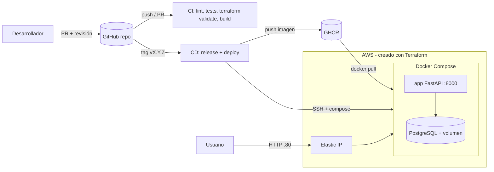
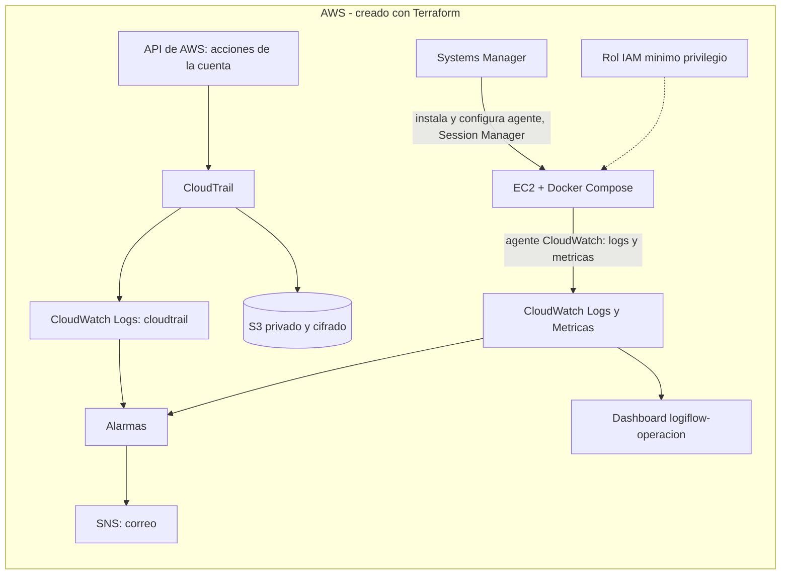

# Arquitectura propuesta

## Monitoreo, logging y seguridad (Evaluación 3)

Recursos de AWS declarados en `infra/terraform`: VPC, subred pública, Internet Gateway, tabla de rutas,
Security Group (80 abierto; 22 solo con clave; 5432 cerrado), Key Pair, instancia EC2 (disco cifrado, IMDSv2),
Elastic IP; rol e instance profile IAM (`iam.tf`); grupos de logs, parámetro SSM con la configuración del agente,
asociaciones SSM, filtros de métricas, tema SNS, 6 alarmas y dashboard (`monitoring.tf`); trail de CloudTrail,
bucket S3 y alarma de llamadas no autorizadas (`cloudtrail.tf`).
