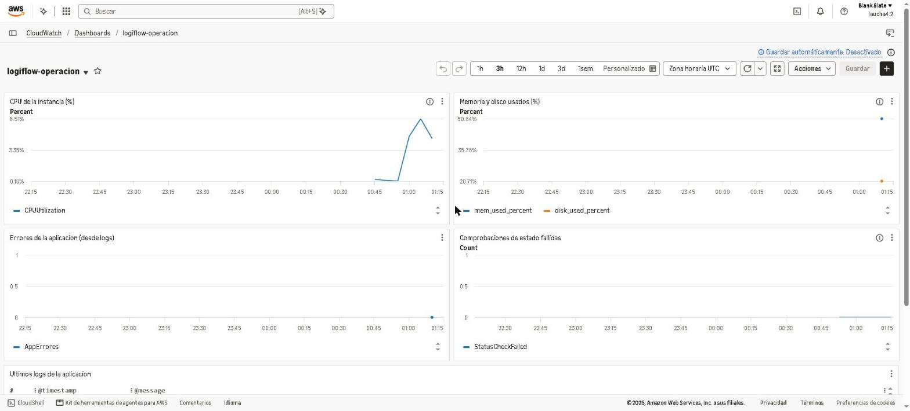
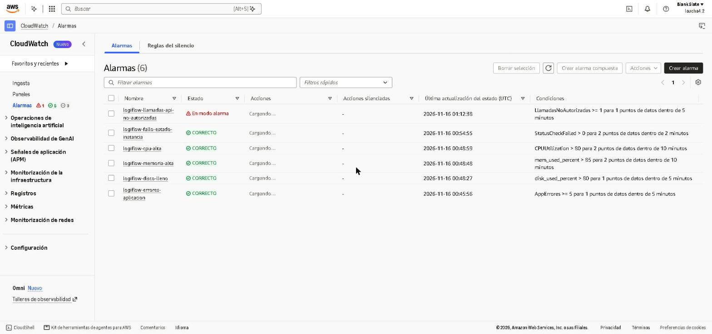
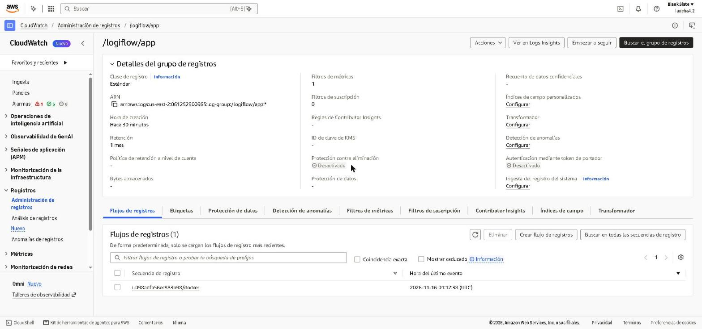
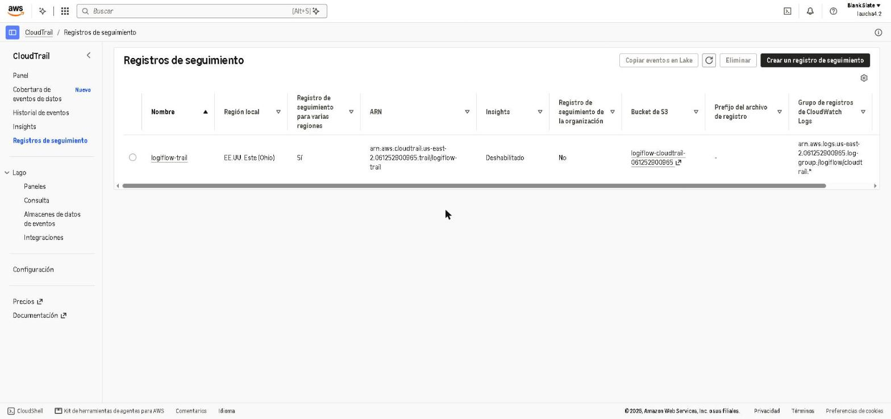
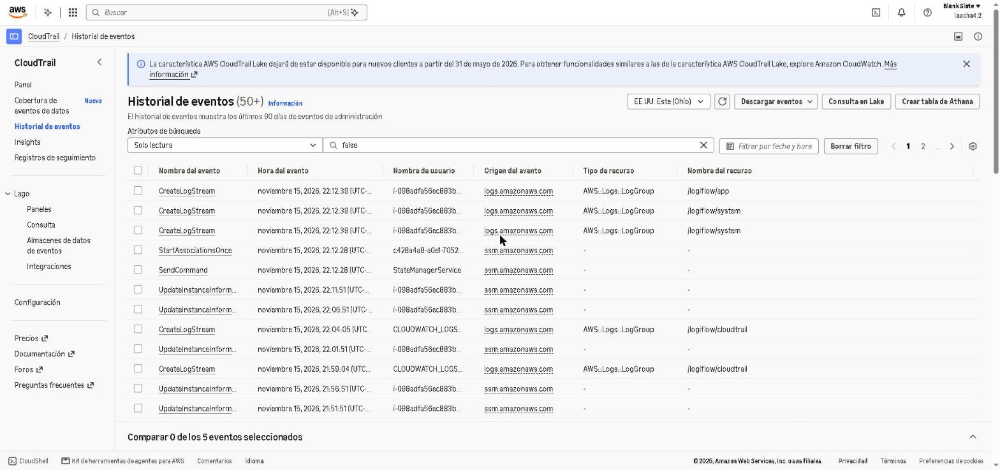
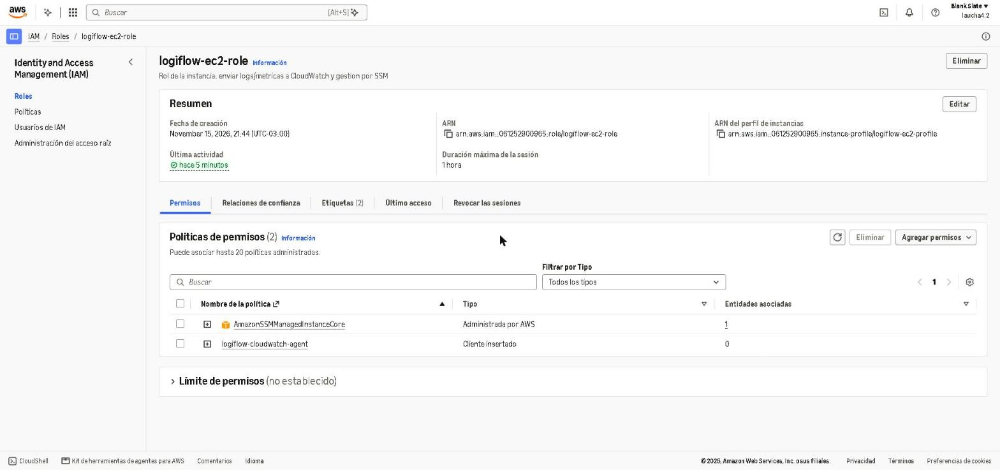
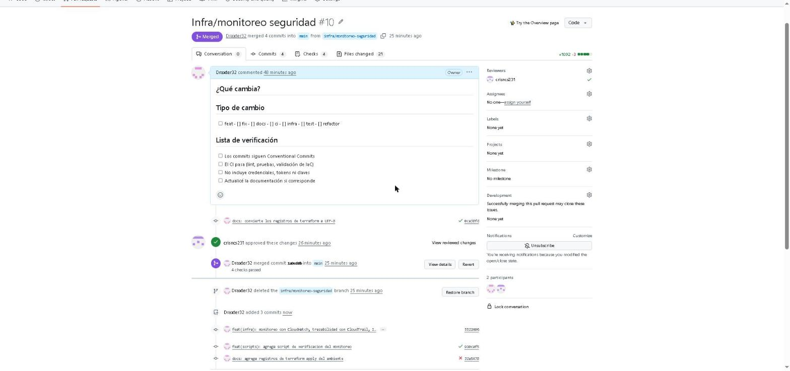
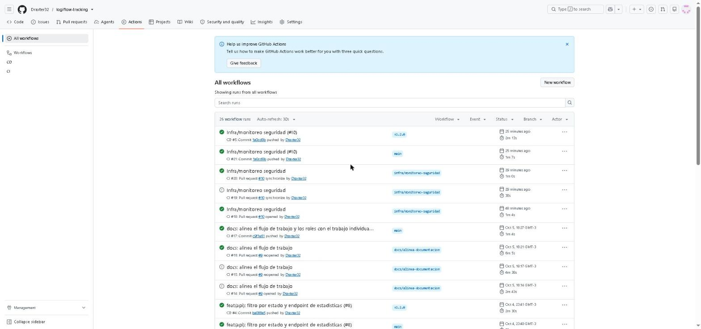
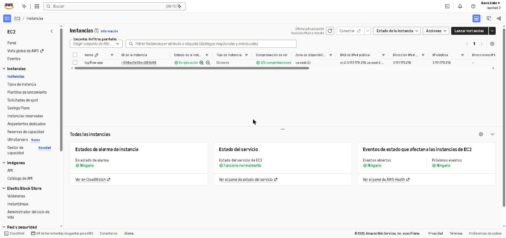

# Informe: evidencia de implementación de infraestructura como código en ambientes Cloud

**Asignatura:** Fundamentos de DevOps · **Carrera:** Ingeniería en Informática · **Sección:** P TILE23
**Estudiante:** Cristopher Menares · **Repositorio:** https://github.com/Draxter32/logiflow-tracking

## 1. Caso y objetivo

LogiFlow SpA es una empresa de entregas de última milla. Necesita saber en qué estado va cada entrega casi en tiempo
real. LogiFlow Tracking es la API que lo permite. Está hecha con FastAPI y PostgreSQL, corre en contenedores Docker y
vive en un servidor (instancia EC2) de AWS.

En la evaluación anterior el servicio ya se desplegaba con Terraform y GitHub Actions. En esta etapa el objetivo es
poder **operarlo con tranquilidad**. Eso significa tres cosas:

- Enterarse rápido cuando algo falla (monitoreo y alarmas).
- Saber quién hizo qué en la cuenta de AWS (auditoría).
- Dar a cada parte solo los permisos que necesita (seguridad).

Todo se declara como código, para que se pueda crear y borrar el ambiente completo con unos pocos comandos.

## 2. Requerimientos

Están escritos en `docs/REQUISITOS.md`. En resumen:

| Tipo | Qué se pide | Cómo se cumple |
|---|---|---|
| Funcional (RF) | Crear toda la infraestructura con código | Terraform, carpeta `infra/terraform` |
| Monitoreo (RM) | Ver logs y métricas en un solo lugar y recibir avisos | CloudWatch, 6 alarmas y avisos por correo (SNS) |
| Seguridad (RS) | Permisos mínimos, sin claves, pocos puertos, disco cifrado | Rol IAM acotado, Security Group, IMDSv2, disco cifrado |
| Trazabilidad (RT) | Registrar las acciones hechas en la cuenta | CloudTrail con bucket S3 privado |

## 3. Diseño de la solución

El diagrama está en `docs/ARQUITECTURA.md`. Funciona así:

1. La instancia EC2 corre la API y la base de datos con Docker Compose.
2. Un agente de CloudWatch, instalado con Systems Manager (SSM), envía los logs y las métricas a CloudWatch.
3. Las alarmas de CloudWatch avisan por correo usando SNS.
4. CloudTrail guarda el registro de acciones en un bucket S3 privado y también lo copia a CloudWatch Logs.

| Archivo de Terraform | Qué define |
|---|---|
| `main.tf`, `variables.tf`, `outputs.tf`, `versions.tf` | Red, Security Group, servidor EC2 e IP fija |
| `iam.tf` | Rol, política de permisos mínimos y perfil de la instancia |
| `monitoring.tf` | Logs, agente, métrica de errores, SNS, 6 alarmas y dashboard |
| `cloudtrail.tf` | CloudTrail, bucket S3 seguro y alarma de llamadas denegadas |

## 4. Infraestructura como código

Todo el ambiente se crea con estos comandos (guía completa en `docs/DEPLOY.md`):

```bash
cd infra/terraform
cp terraform.tfvars.example terraform.tfvars   # se completan la clave SSH pública y el correo de alertas
terraform init
terraform plan -out tfplan
terraform apply tfplan
```

Con esto Terraform crea los recursos de red, el servidor, los permisos, el monitoreo y CloudTrail. El estado de la
infraestructura queda en un archivo y los cambios se revisan con `terraform plan` antes de aplicarlos. Los cambios al
código pasan por un pull request con la revisión de otra persona antes de llegar a `main`.

## 5. Monitoreo y logging

El detalle está en `docs/MONITOREO.md`. Lo que se monitorea:

- **Logs:** los de los contenedores (`/logiflow/app`) y los del sistema (`/logiflow/system`). Se guardan 30 días.
- **Métricas:** uso de CPU, memoria y disco, y el estado de la instancia.
- **Errores de la aplicación:** un filtro cuenta los errores que aparecen en los logs (métrica `AppErrores`).
- **Dashboard:** `logiflow-operacion` junta todo en una sola pantalla.
- **Alarmas (6):** CPU alta, falla de estado de la instancia, memoria alta, disco lleno, errores de la aplicación y
  llamadas a la API no autorizadas. Todas avisan por correo.

## 6. Pruebas automatizadas

El detalle está en `docs/PRUEBAS.md`. Todo se ejecuta solo en GitHub Actions cada vez que hay un cambio:

- Pruebas de la API (con pytest).
- **14 pruebas de la infraestructura** (`tests/infra`) que leen el código de Terraform y comprueban cosas como: la base
  de datos no está abierta a internet, el disco está cifrado, no hay claves escritas en el código y existen las alarmas.
- Revisión de estilo y de seguridad del código (ruff y bandit) y de las dependencias (pip-audit).
- Validación de Terraform y una prueba rápida de que la API responde después de cada despliegue.

## 7. Seguridad DevOps

El detalle está en `docs/SEGURIDAD.md`.

- **Permisos mínimos:** el servidor usa un rol IAM con solo dos políticas: la de Systems Manager y una propia que solo
  permite escribir logs y métricas de LogiFlow. No hay claves de acceso en el servidor.
- **Secretos:** las contraseñas y llaves están en GitHub Secrets, no en el código.
- **Red:** solo están abiertos los puertos necesarios. La base de datos no es accesible desde internet.
- **Servidor:** disco cifrado y metadatos protegidos (IMDSv2).
- **Auditoría:** CloudTrail registra las acciones, valida que los archivos no se alteren y una alarma avisa si hay
  llamadas denegadas.
- **Riesgo que queda:** el puerto 22 sigue abierto para el despliegue por SSH. Se protege con llave y se anota como
  riesgo, con la mejora de reemplazarlo por Session Manager.

## 8. Evidencias

Las capturas están en la carpeta `docs/evidencia/`.

| Qué muestra | Archivo |
|---|---|
| Dashboard con CPU, memoria, disco, errores y estado | `cloudwatch-dashboard.jpg` |
| Las 6 alarmas | `cloudwatch-alarmas.jpg` |
| Logs de la aplicación llegando a CloudWatch | `cloudwatch-logs-app.jpg` |
| CloudTrail configurado (varias regiones, S3 y CloudWatch) | `cloudtrail-trail.jpg` |
| Eventos de la cuenta registrados por CloudTrail | `cloudtrail-eventos.jpg` |
| Rol IAM con solo dos políticas | `iam-rol.jpg` |
| Pull request fusionado con aprobación y revisiones | `github-pr-10.jpg` |
| Pipeline de GitHub Actions en verde y despliegue v1.2.0 | `actions-verde.jpg` |
| Servidor EC2 en ejecución | `ec2-instancia.jpg` |
| Registro de `terraform apply` | `terraform-apply*.log` |



















En la captura de alarmas, cinco están en estado correcto y la de llamadas no autorizadas aparece en alarma. Es el
comportamiento esperado: durante el despliegue hubo llamadas denegadas y la alarma las detectó, lo que comprueba que la
detección funciona.

## 9. Reflexión final

En esta etapa aprendí que la infraestructura no está lista cuando el servidor queda andando. Si no hay logs ni alarmas,
no hay forma de saber que algo falló, y si no hay registro de acciones, no se puede explicar qué cambió ni quién lo hizo.
Definir primero los requerimientos de monitoreo y seguridad me ayudó a decidir qué alarmas crear y qué permisos dar,
porque cada recurso responde a una necesidad concreta. Escribir pruebas que leen el código de Terraform fue útil porque
revisan esos requerimientos en cada pull request, antes de gastar tiempo o dinero en AWS.

Tuve varias dificultades:

- **Permisos del rol IAM:** costó dejar el rol realmente acotado. `PutMetricData` no se puede limitar por recurso, así
  que lo limité por espacio de nombres.
- **Agente de CloudWatch:** la asociación que configura el agente se ejecutó antes de que terminara la que lo instala,
  y por eso no enviaba logs. Lo resolví aplicando de nuevo la asociación y los logs empezaron a llegar. Como mejora,
  se puede programar que se vuelva a ejecutar sola cada cierto tiempo.
- **Instalación de Docker:** en el servidor nuevo no quedó instalado desde el arranque y lo instalé por SSH. Una mejora
  sería pasar esa instalación también a Systems Manager para que quede como código.
- **Puerto 22:** el despliegue por SSH necesita ese puerto, lo que choca con la idea de cerrarlo. Lo dejé documentado
  como riesgo.

La solución mejora tres cosas. En la **operación**, porque los problemas se detectan por correo y no porque alguien
reclama. En la **seguridad**, porque los permisos son mínimos y las acciones quedan registradas. Y en la
**automatización**, porque el ambiente completo, con su monitoreo, se crea y se borra con código. Al terminar la
práctica se borra con `terraform destroy` para no generar costos.

## Referencias

Amazon Web Services. (s. f.-a). *Amazon CloudWatch User Guide*. https://docs.aws.amazon.com/AmazonCloudWatch/latest/monitoring/WhatIsCloudWatch.html

Amazon Web Services. (s. f.-b). *AWS CloudTrail User Guide*. https://docs.aws.amazon.com/awscloudtrail/latest/userguide/cloudtrail-user-guide.html

Amazon Web Services. (s. f.-c). *AWS Systems Manager User Guide*. https://docs.aws.amazon.com/systems-manager/latest/userguide/what-is-systems-manager.html

Amazon Web Services. (s. f.-d). *Security best practices in IAM*. AWS Identity and Access Management User Guide. https://docs.aws.amazon.com/IAM/latest/UserGuide/best-practices.html

Center for Internet Security. (s. f.). *CIS Amazon Web Services Foundations Benchmark*. https://www.cisecurity.org/benchmark/amazon_web_services

HashiCorp. (s. f.). *Terraform documentation*. https://developer.hashicorp.com/terraform/docs
